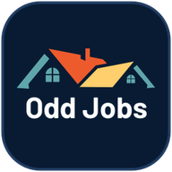

<div align="center">
  

  <h1>Odd Jobs — Your Residential Handyman Service</h1>

  <p>
    Production web application for <strong>Odd Jobs Your Residential Handyman Service</strong> (Butch &amp; Joy Roberts), serving homeowners across St. Charles, Geneva, and the Fox Valley, IL.
  </p>

  <p>
    <a href="https://odd-jobs-residential.vercel.app">Live Site (Vercel)</a>
    &nbsp;&middot;&nbsp;
    <a href="https://github.com/alvinmonir411/odd-jobs-residential">GitHub Repository</a>
  </p>

  <p>
    
    
    
    
    
  </p>
</div>

---

## Overview

A fast, conversion-focused Next.js App Router marketing website built to showcase small home repair, home maintenance, and pre-listing preparation services handled by husband-and-wife owners **Butch and Joy Roberts** (30+ years of hands-on residential experience, fully insured).

> **Note on Vercel Preview Protection:** The production alias (`https://odd-jobs-residential.vercel.app`) is hosted under team deployment protection (`vercel_authentication` for non-custom `.vercel.app` domains). Authenticated Vercel team members can access the deployment directly, or a custom domain / Deployment Protection adjustment can open public access.

---

## Key Features

- **Authentic Local Brand Experience:** Features real service offerings, business hours (Mon–Sat open for quotes, Sunday closed), St. Charles / Fox Valley service coverage, customer reviews (including verified Google review), and branded logo/favicon assets (`icon.png`, `apple-icon.png`, `favicon.ico`).
- **Interactive Quote Request Flow (`QuoteModal`):** Accessible quote modal triggered across the Navbar, Hero CTA, Service cards (auto-preselecting the chosen service), About CTA, FAQ CTA, Banner CTA, and Footer — with quick-action `Call`, `Text`, and `Email` (`tel:`, `sms:`, `mailto:`) options.
- **High-Resolution Media Optimization:** Served through `next/image` with custom `qualities: [75, 95]` configured in `next.config.ts` so owner portraits render at Q=95 clarity alongside responsive sizing.
- **Smooth Motion & Scroll Reveals:** Lightweight `IntersectionObserver` reveal system (`ScrollReveal`) combined with GPU-accelerated CSS keyframes in `src/app/globals.css`, complete with `@media (prefers-reduced-motion: reduce)` support.
- **Responsive Navigation & Carousels:** Sticky header with desktop Services dropdown and accessible mobile navigation drawer, interactive FAQ accordion (`View All FAQs` / `Show Fewer FAQs`), and multi-card testimonials carousel.

---

## Tech Stack

| Layer | Technology | Version / Details |
| :--- | :--- | :--- |
| **Framework** | Next.js (App Router + Turbopack) | `^16.4.6` |
| **UI Library** | React / React DOM | `^19.3.1` |
| **Language** | TypeScript (`strict: true`) | `~7.0.2` |
| **Styling** | Tailwind CSS v4 (`@tailwindcss/postcss`) | `^4.3.5` |
| **Typography** | `Plus Jakarta Sans` & `Inter` | Loaded via `next/font/google` |
| **Icons** | `lucide-react` | `^1.72.0` |
| **Linting** | `oxlint` | `^1.90.0` (137 rules) |
| **Hosting** | Vercel | Static prerendered production build (`iad1`) |

---

## Project Structure

```text
odd-jobs-residential/
├── public/
│   └── images/                 # Brand logos, owner portrait, hero/service/FAQ/avatar photos
├── src/
│   ├── app/
│   │   ├── apple-icon.png      # Apple touch icon (180x180)
│   │   ├── favicon.ico         # Multi-resolution browser favicon (16/32/48)
│   │   ├── globals.css         # Tailwind v4 theme tokens & smooth animation keyframes
│   │   ├── icon.png            # Primary PNG app icon (192x192)
│   │   ├── layout.tsx          # Root server layout, Google fonts & OpenGraph metadata
│   │   └── page.tsx            # Main landing page composition
│   ├── components/
│   │   ├── AboutSection.tsx        # Owners circular showcase, highlights & 4-metric stats card
│   │   ├── CtaBannerSection.tsx    # Bottom conversion banner
│   │   ├── FaqSection.tsx          # Interactive FAQ accordion & toggle
│   │   ├── Footer.tsx              # 5-column dark-navy footer with transparent full brand logo
│   │   ├── HeroSection.tsx         # Staggered hero layout, floating call card & trust strip
│   │   ├── Navbar.tsx              # Sticky navigation bar, service dropdown & mobile drawer
│   │   ├── ProcessSection.tsx      # 4-step workflow overview
│   │   ├── QuoteModal.tsx          # Pre-fillable quote request dialog
│   │   ├── QuoteProvider.tsx       # React Context state for opening/closing QuoteModal
│   │   ├── ScrollReveal.tsx        # IntersectionObserver scroll-entrance wrapper
│   │   ├── ServicesSection.tsx     # 6 split service cards with modal triggers
│   │   ├── TestimonialsSection.tsx # Customer reviews carousel + Google Reviews link
│   │   └── WhyChooseUsSection.tsx  # 5-pillar dark section + studio-framed owners portrait
│   └── data/
│       └── siteContent.ts      # Centralized typed business copy, services, FAQs & reviews
├── next.config.ts              # Next.js Image quality presets ([75, 95])
├── package.json
├── postcss.config.mjs
└── tsconfig.json
```

---

## Getting Started

### Prerequisites

- **Node.js** `20.x` or later (`v24+` recommended)
- **npm** `10+`

### Local Development

```bash
# 1. Clone the repository
git clone https://github.com/alvinmonir411/odd-jobs-residential.git
cd odd-jobs-residential

# 2. Install dependencies
npm install

# 3. Start the Next.js development server (Turbopack)
npm run dev
```

Open [http://localhost:3000](http://localhost:3000) in your browser.

---

## Available Scripts

| Command | Description |
| :--- | :--- |
| `npm run dev` | Starts the local Next.js development server with Turbopack on port `3000` |
| `npm run build` | Creates an optimized static & production build and runs TypeScript type checking |
| `npm run start` | Serves the production build locally after `npm run build` |
| `npm run lint` | Runs `oxlint` across the codebase |

---

## Customization

1. **Business Content & Copy:** Edit [`src/data/siteContent.ts`](src/data/siteContent.ts) to update phone numbers, email, service descriptions, operating hours, FAQ items, or testimonials without touching component layout code.
2. **Design Tokens & Animations:** Update brand colors, typography variables, shadows, and keyframe curves in the `@theme` block of [`src/app/globals.css`](src/app/globals.css).

---

## Deployment

Verified production build and deployment via Vercel CLI:

```bash
npm run lint
npm run build
npx vercel deploy --prod
```

- **Production URL:** https://odd-jobs-residential.vercel.app
- **Project Root Directory:** `.` (Next.js App Router default output `.next`)

---

## Business Details

- **Business:** Odd Jobs Your Residential Handyman Service
- **Owners:** Butch &amp; Joy Roberts
- **Service Area:** St. Charles, Geneva &amp; Fox Valley, IL (`136 Lakeside Dr Unit 722, Saint Charles, IL 60174-7915`)
- **Phone / Text:** `(630) 940-6935` &middot; **Email:** `oddjobs.jb@gmail.com`
